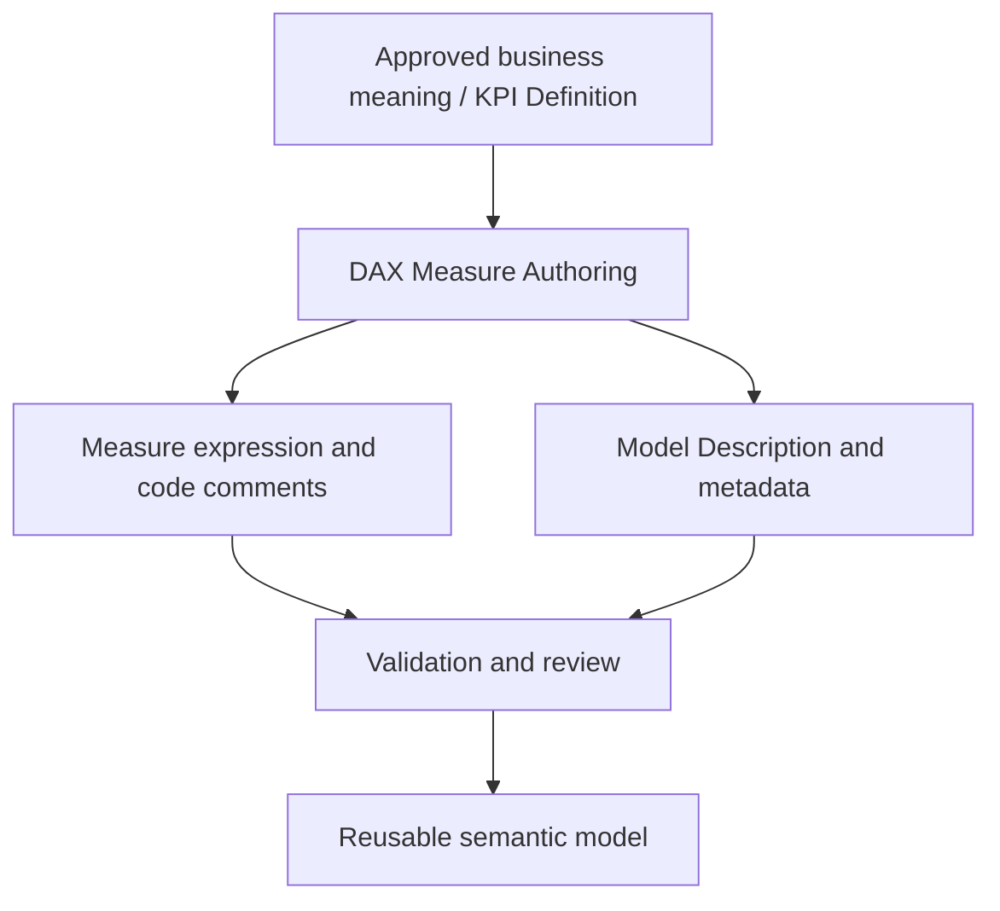

# DAX Measure Authoring Guide

**Clear names. Correct aggregation. Explicit filter context. Documented meaning.**

This resource gives practical, reviewable conventions for creating Power BI DAX measures. It complements the *Semantic Modeling Guideline* and the separate KPI and Measure Documentation templates.

> **Business meaning comes first. A readable calculation does not replace a verified business definition.**

## Guides and example

- [Deutsch | DAX Measures schreiben und dokumentieren](dax_measure_authoring_de.md)
- [English | DAX Measure Authoring Guide](dax_measure_authoring_en.md)
- [DAX Query View example](dax_query_view_example.dax)

## What you will learn

| Topic | Principle |
| --- | --- |
| Business-facing names | Describe the result without an unnecessary technical prefix |
| Time and comparison suffixes | Make period, comparison base and result type explicit |
| Aggregation and calculation type | Distinguish a sum, an average of rows, a per-order average, a distinct count and a ratio |
| Additivity and filter scope | Document additive / semi-additive / non-additive behavior separately from DAX functions; clarify intentionally removed filters |
| Variables and formatting | Use readable DAX with descriptive `VAR` names and `RETURN` |
| Code comments | Explain non-obvious choices using `//` or `/* ... */` |
| Model descriptions | Use the **Description** property; in **DAX Query View**, `///` immediately above `MEASURE` can write it to the model |
| Metadata beyond DAX | Maintain format strings and display folders; use business-approved synonyms where useful for natural-language query scenarios |
| Review and tests | Verify totals, aggregation grain, additive behavior, filter context, time intelligence, blanks, format and intended AI-facing behavior |

**Recommendation:** This version gives you a strong foundation for consistent DAX authoring. To keep naming conventions, documentation and review aligned, carry the same criteria into the [Measure Documentation Template](../measure_documentation/README.md) and [Semantic Model Review Checklist](../../04_validation/semantic_model_review_checklist/README.md). Both resources already include matching fields and checks for naming, calculation and aggregation behavior, filter context, Descriptions and validation; keep them synchronized as the guide evolves.

## Three naming approaches

1. **Business-first, no prefix (recommended):** `Revenue`, `Average Line Amount`, `Average Order Value`, `Revenue PY`, `Revenue vs PY %`, `Gross Margin %`.
2. **Fully spelled out:** `Revenue Previous Year`, `Revenue Change vs Previous Year %`. Useful for audiences unfamiliar with acronyms, but longer.
3. **Technical prefixes for all measures:** `m_Revenue`, `KPI_Revenue`. Generally **not recommended for user-facing measures**; consider a prefix only for clearly separate technical formatting measures, as described by `NAM-005/006`.

Choose **one coherent convention per model**. Don't use naming to invent or imply business rules that have not been approved.

## Naming measures: the calculation matters, but business meaning comes first

| Example name | Aggregation | Clarification |
| --- | --- | --- |
| `Revenue` | `SUM ( FactSales[NetAmount] )` | The confirmed KPI may be additive; `SUM` does not need to appear in every name. |
| `Average Line Amount` | `AVERAGE ( FactSales[NetAmount] )` | Average **per line** (not automatically per order). |
| `Average Order Value` | `DIVIDE ( [Revenue], [Order Count] )` | Average **per order**; the denominator must be agreed. |
| `Order Count` | `DISTINCTCOUNT ( FactSales[OrderID] )` | Counts distinct IDs, not rows. |
| `Revenue All Regions` | `CALCULATE ( [Revenue], REMOVEFILTERS ( DimRegion ) )` | Removes **region filters only**; other applicable filters and RLS still apply. |
| `Revenue vs PY %` | Relative prior-year change | Comparison basis and zero / missing prior year must be specified. |

**Do not confuse these three properties:**

- **Calculation / aggregation method:** `SUM`, `AVERAGE`, `DISTINCTCOUNT`, weighted average, division of two measures, etc.
- **Aggregation behavior:** additive, semi-additive or non-additive across relevant dimensions. This is a *business property*, not a DAX function name. A balance can be summed across accounts but not across dates.
- **Filter-context behavior:** which filters are preserved or intentionally removed. `ALL` and `REMOVEFILTERS` are not aggregation methods.

If a naming difference changes business interpretation, make it explicit. Do **not** automatically append `_SUM`, `_AVG` or `_ALL` to every measure. The English and German guides include complete DAX examples and additional review checks.

## `//` versus `///`: an important difference

| Syntax | Where | Result |
| --- | --- | --- |
| `// Explain a filter choice` | **Inside a DAX expression** | Code comment; **not** the semantic model Description |
| `/* Explain a complex assumption */` | **Inside a DAX expression** | Multi-line code comment |
| `/// Business explanation` | **Immediately above `MEASURE` in DAX Query View's `DEFINE` block**, then **Update model with changes** | Saves the measure's **Description** property in supported Power BI workflows |
| `/// Business explanation` | **Immediately above `measure` in a TMDL object definition** | TMDL object Description (subject to successful model update) |

Pasting `///` inside the **measure formula bar** is **not** the same as updating the Description property. To maintain descriptions in the GUI, use the **Properties pane**; to save them in DAX Query View, use the **Update model** action. See [Microsoft's DAX Query View documentation](https://learn.microsoft.com/en-us/power-bi/transform-model/dax-query-view).

## Where this belongs

| Related resource | Purpose |
| --- | --- |
| [KPI Definition Sheet](../kpi_definition/README.md) | Confirm the **business definition** and owner |
| [Measure Documentation](../measure_documentation/README.md) | Maintain detailed implementation dependencies and test cases |
| [Metadata Description Guide](../metadata_description_guide/README.md) | Write clear, concise descriptions in the model |
| [Semantic Model Specification](../semantic_model_specification/README.md) | Describe the model-wide design and requirements |
| [Semantic Model Review Checklist](../../04_validation/semantic_model_review_checklist/README.md) | Verify model behavior, metadata and release criteria |

## Guideline alignment

**Guideline alignment:** `NAM-001`–`NAM-006`, `DAX-001`–`DAX-008`, `DOC-002`–`DOC-004`, `DOC-010`–`DOC-011`, and Sections 12 and 15.3–15.4. The concrete naming patterns, inline-comment style, and additional examples in this resource remain **supplementary proposals**, not automatically approved company rules. The source guideline is *v0.1 (Draft), November 16, 2026*.

## Further reading

- [Microsoft: DAX Query View and `///` descriptions](https://learn.microsoft.com/en-us/power-bi/transform-model/dax-query-view)
- [Microsoft: Optimize a semantic model for Copilot](https://learn.microsoft.com/en-us/power-bi/create-reports/copilot-evaluate-data)
- [Microsoft: TMDL descriptions](https://learn.microsoft.com/en-us/analysis-services/tmdl/tmdl-overview)
- [SQLBI: DAX naming conventions](https://docs.sqlbi.com/dax-style/dax-naming-conventions)
- [SQLBI: DAX formatting](https://docs.sqlbi.com/dax-style/dax-format)

---

## Changelog

- **2026-11-16** — `README.md`: removed a link to the unavailable proposed-guideline-additions file. Existing Semantic Modeling Guideline: v0.1 (Draft).
- **2026-11-16** — `README.md`, `dax_measure_authoring_de.md`, `dax_measure_authoring_en.md`: aligned rule references, synonym guidance, and the source date with the current v0.1 (Draft) guideline.
- **2026-11-16** — `README.md`: added a recommendation to keep DAX naming, measure documentation and review criteria aligned.

## 🔗 Related content

🎥 YouTube: [Power BI with AI Vibes](https://www.youtube.com/@BIVibes-JasminSimader)  
🏠 Website: [Jasmin Simader](https://www.jasminsimader.com/)  
👩🏻‍💻 LinkedIn: [Jasmin Simader](https://www.linkedin.com/in/jasmin-simader)  
📝 Blog / Substack: [Substack](https://substack.com/@datatherapywithjasmin)
