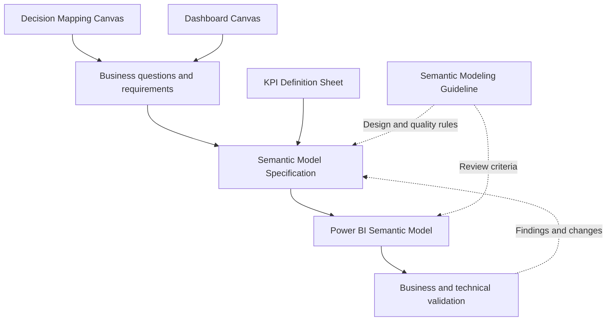

# Semantic Model Specification

**From Business Requirements to a Reliable Semantic Model**

The **Semantic Model Specification** connects agreed business needs with the intended structure, behavior, security, and operating requirements of a Power BI semantic model.

> **Specify business meaning and model responsibilities before implementation. Validate the result against what was agreed.**

## Purpose

Use this specification to make the key design decisions for a semantic model understandable and reviewable. It is a **model-level document**, not a replacement for a KPI Definition Sheet, a technical inventory of every object, or the Power BI Semantic Modeling Guideline.

It supports both planning and maintenance. Record planned requirements first, then link to the implemented solution and review evidence. Do not mark a design as validated simply because it was documented.

## Templates

- [Deutsch | Semantic-Model-Spezifikation](semantic_model_specification_de.md)
- [English | Semantic Model Specification](semantic_model_specification_en.md)

Create a separate copy for each semantic model. Mark details as **open**, **not applicable**, or **confirmed** rather than guessing.

## What it contains

| Section | Key question |
| --- | --- |
| 1. Model overview | What is the model, why does it exist and who owns it? |
| 2. Business context and scope | Which decisions, questions and consumers does it serve? |
| 3. Sources and dependencies | Which inputs, quality conditions and refresh assumptions apply? |
| 4. Model structure | What are the facts, grains, dimensions, keys and relationships? |
| 5. KPIs and measures | Which approved KPI definitions are implemented? |
| 6. Time and filter context | How do time, aggregation and filtering affect interpretation? |
| 7. Security and governance | Which access rules, owners and restrictions apply? |
| 8. Performance and operations | Which storage mode, usage and refresh conditions must be supported? |
| 9. Validation and acceptance | How will correctness and readiness be demonstrated? |
| 10. Decisions, risks and changes | Which choices, exceptions and open items must remain traceable? |

## How the resources fit together

This is a **relationship map**, not a mandatory waterfall process. A shared semantic model can support many decisions and reports. A Dashboard Canvas is not required when no particular dashboard is being designed.

## Suggested workflow

1. **Clarify purpose and scope.** Reference relevant decisions and business questions, where available.
2. **Link agreed KPI definitions.** Do not duplicate the full meaning or calculation in this document.
3. **Specify the model.** Capture sources, fact grains, dimensions, relationship decisions, security and storage-mode rationale.
4. **Identify risks and open questions.** Assign owners and expected resolution points.
5. **Implement and validate.** Link the actual model artifacts and review evidence; distinguish planned from verified behavior.
6. **Maintain the specification.** Update it when business meaning, sources or model behavior change.

## Boundaries and responsibilities

| Artifact | Responsibility |
| --- | --- |
| [Decision Mapping Canvas](../../01_decision_design/decision_mapping_canvas/README.md) | Clarifies the decision context and intended actions. |
| [Dashboard Canvas](../../02_requirements_stakeholder/dashboard_canvas/README.MD) | Clarifies requirements of a specific dashboard or report. |
| [KPI Definition Sheet](../kpi_definition/README.md) | Establishes business meaning, calculation, owner and validation of a KPI. |
| **Semantic Model Specification** | Describes the model-wide solution design and its assumptions and constraints. |
| **Semantic Modeling Guideline** | Defines proposed modeling, documentation and review rules. |

## Alignment with the guideline

This template draws from the *Semantic Modeling in Power BI* guideline, **Version 0.1 (Draft), November 16, 2026**, especially **SEM-001–SEM-005**, **NAM-006**, **DAX-008**, **DOC-001/002/010/011**, the model design chapters, **Section 12 (Quality assurance and approval)**, **Section 14 (Definition of done)**, and **Section 15 (Templates for practical use)**.

The specification is an **additional practical resource**, not an existing prescribed form within the guideline. The guideline's MUST/SHOULD/MAY labels are proposed classifications pending formal organizational approval.

## Suggested status labels

`Draft` · `In review` · `Agreed design` · `Implemented` · `Validated` · `Superseded`

Status applies to the document or design, **not automatically to production release approval**.

## Changelog

- **2026-11-16:** Updated the guideline reference date; aligned the German and English template references.
- **2026-11-16:** Added optional natural-language query use and validation fields to both language templates to support DOC-010 review in the target product.

---

## 🔗 Related content

🎥 YouTube: [Power BI with AI Vibes](https://www.youtube.com/@BIVibes-JasminSimader)  
🏠 Website: [Jasmin Simader](https://www.jasminsimader.com/)  
👩🏻‍💻 LinkedIn: [Jasmin Simader](https://www.linkedin.com/in/jasmin-simader)  
📝 Blog / Substack: [Substack](https://substack.com/@datatherapywithjasmin)
