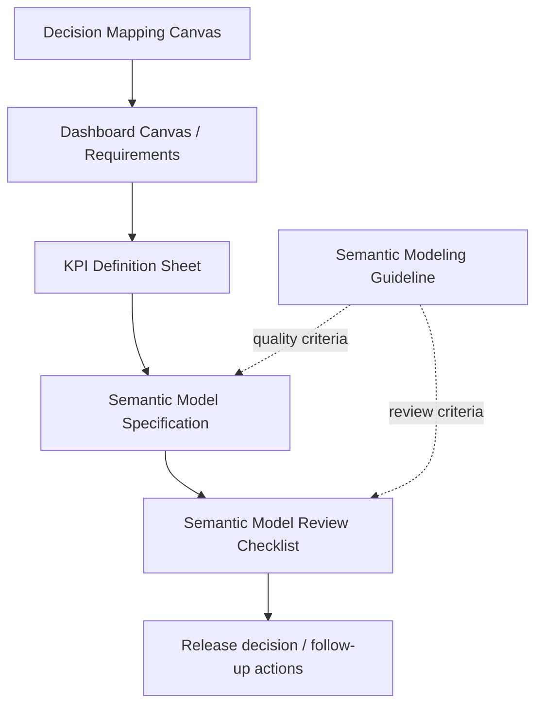

# Semantic Model Review Checklist

**Review business meaning, model quality, security, and readiness before release.**

The **Semantic Model Review Checklist** makes the quality assurance criteria from **Section 12.1** of the *Power BI Semantic Modeling Guideline* usable in a repeatable review workflow.

Its guiding principle is:

> **A successful deployment does not prove that a model is correct, secure, or ready for use.**

## Purpose

Use the checklist to record **business and technical checks**, supporting evidence, review findings, and exceptions. The resource also includes the production release conditions from Section 12.2 and an exception log aligned with Section 13 of the guideline.

**Guideline version:** 0.1 (Draft), November 16, 2026. The proposed MUST/SHOULD/MAY classifications are **not automatically binding organizational standards**.

## Download the templates

- [Deutsch | Semantic Model Review Checklist](semantic_model_review_checklist_de.md)
- [English | Semantic Model Review Checklist](semantic_model_review_checklist_en.md)

Copy a template for each model review and fill in the review metadata, status and evidence. The templates are intentionally unapproved and all checks start as `Open`.

## Review coverage

| Area | Review focus |
| --- | --- |
| Business meaning | Purpose, audience, decisions, KPI ownership and limitations |
| Model structure | Fact grain, keys, cardinalities, filter directions, date modeling |
| Measures and DAX | Explicit measures, business-oriented names, calculation versus aggregation behavior, filter scope, totals reconciliation and DAX style |
| Data preparation and operations | Sources, freshness, transformations, storage mode, refresh and performance |
| Security and documentation | Effective access, RLS/OLS, groups, owners, descriptions, synonym review and natural-language query testing where relevant, dependencies |
| Text-based development and automation | PBIP/TMDL diffs, syntax checks, metadata tests and AI-generated descriptions |
| Release readiness | Business confirmation, security, performance, dependent reports and approvals |

## Suggested workflow

1. **Define review scope.** New production models need business and technical review. For changes to existing models, adjust depth to risk and impact (guideline `QA-001`).
2. **Link the inputs.** Reference the [Semantic Model Specification](../../03_semantic_modelling/semantic_model_specification/README.md) and the [KPI Definition Sheet](../../03_semantic_modelling/kpi_definition/README.md), where available.
3. **Review each applicable check.** Mark `Pass`, `Fail`, `Open`, or `N/A`, recording traceable evidence. Explain `N/A`.
4. **Record findings and exceptions.** An exception requires documented rationale, alternatives, risks, approval, and a review date as described in guideline Section 13.
5. **Verify release conditions separately.** The production release section is distinct from the review findings.
6. **Keep a dated review record.** Save the completed checklist alongside the model release or change request.

## Relationship to the other resources

This diagram illustrates traceability, **not a mandatory waterfall process**. A semantic model may support multiple decisions, KPIs and dashboards.

## Important boundaries

- A completed checklist **is not automatically a production approval**.
- A passed metadata check **does not substitute for a business validation**.
- Critical issues must be fixed or handled through an approved exception before release, following the organizational process.
- Do not silently mark untested criteria as passed.

## Changelog

- **2026-11-16:** Corrected links to the semantic-modelling resources and clarified synonym review and natural-language query testing coverage.
- **2026-11-16:** Updated both language templates for NAM-006, DAX-008 and DOC-011, including name, aggregation, filter-scope, DAX-style and saved-Description checks.

---

## 🔗 Related content

🎥 YouTube: [Power BI with AI Vibes](https://www.youtube.com/@BIVibes-JasminSimader)  
🏠 Website: [Jasmin Simader](https://www.jasminsimader.com/)  
👩🏻‍💻 LinkedIn: [Jasmin Simader](https://www.linkedin.com/in/jasmin-simader)  
📝 Blog / Substack: [Substack](https://substack.com/@datatherapywithjasmin)
