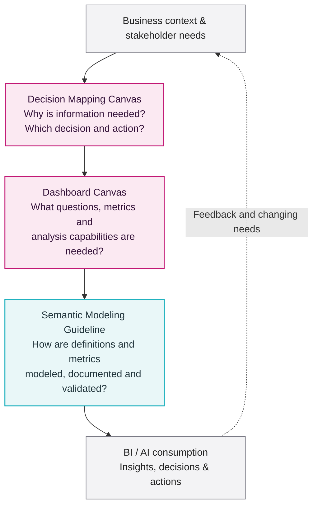

# Practical Resources & Templates

**From business decisions to reliable insights and meaningful actions.**

This folder brings together practical tools for connecting **business decisions, information requirements, semantic modeling, and the use of insights**.

The resources complement the **Power BI Semantic Modeling Guideline**. They help teams clarify *why* information is needed, *what* an analytical solution should provide, and *how* business meaning can be represented reliably in a semantic model.

The guiding principles are:

> **Decision before metric. Action before reporting. Meaning before technology.**

## How the resources fit together

**How to read this diagram:** It shows a logical connection between the resources, **not a mandatory sequence of approval gates**. A semantic model can support several reports, decisions, or AI use cases. Teams can use each canvas independently and revisit earlier assumptions as they learn more.

## Resource traceability

This table maps each resource to its reference in the [English guideline](../guidelines/Guideline_Semantic_Modelling_Power_BI.pdf) and [German guideline](../guidelines/Guideline_Semantische_Modellierung_Power_BI.pdf). **Guideline content** is part of the guideline; **additional supporting resources** are separate practical tools and templates. The guideline is a draft, and these supporting resources do not create additional mandatory standards.

| Resource | Guideline reference | Main output | Type |
| --- | --- | --- | --- |
| [Decision Mapping Canvas](01_decision_design/decision_mapping_canvas/README.md) | SEM-001 | Decision context | Additional supporting resource |
| [Dashboard Canvas](02_requirements_stakeholder/dashboard_canvas/README.MD) | SEM-001 to SEM-005 | Business and analysis requirements | Additional supporting resource |
| [KPI Definition Sheet](03_semantic_modelling/kpi_definition/README.md) | 15.1, DOC-002 | Agreed KPI meaning | Additional supporting resource |
| [Semantic Model Specification](03_semantic_modelling/semantic_model_specification/README.md) | DOC-001 | Model design specification | Additional supporting resource |
| [Table Documentation](03_semantic_modelling/table_documentation/README.md) | 15.2 | Table-level documentation | Guideline content |
| [Measure Documentation](03_semantic_modelling/measure_documentation/README.md) | 15.3 | Measure-level documentation | Guideline content |
| [Metadata Description Guide](03_semantic_modelling/metadata_description_guide/README.md) | 15.4, DOC-003 | Short model-object descriptions | Guideline content |
| [Semantic Model Review Checklist](04_validation/semantic_model_review_checklist/README.md) | Chapter 12 | Review evidence and findings | Additional supporting resource |

## Which resource should I use?

**Start with the Decision Mapping Canvas** when a stakeholder asks for a new KPI or report, but the underlying decision, responsible person, decision timing, or possible action is not yet clear.

**Use the Dashboard Canvas** when a dashboard or report is a suitable solution and its users, business questions, measures, dimensions, data requirements, and success criteria need to be agreed.

**Use the Semantic Modeling Guideline** when designing, implementing, reviewing, or improving a Power BI semantic model. It is relevant even when no new dashboard is being developed.

The canvases support **requirements clarification**. They do not themselves approve KPI definitions, guarantee data quality, or replace a formal data contract, where one is needed.

## Working together

1. **Clarify the decision.** Identify the business problem, decision maker, timing, action options, and interpretation risks.
2. **Specify the information need.** Translate the relevant decisions into business questions, measures, dimensions, and practical requirements for the intended analytical experience.
3. **Agree on business meaning.** Confirm metric definitions, responsibilities, data sources, scope, and limitations with the relevant owners.
4. **Build and validate.** Apply the Semantic Modeling Guideline to implement and review the model; check whether the resulting information supports the original decision.
5. **Learn and refine.** Revisit requirements and definitions when decisions, business processes, or data change.

These are suggested activities, not compulsory documentation steps. Avoid duplicating information across the canvases: reference an agreed decision context instead of maintaining competing versions of it.

## Templates and languages

Open the resource folders above for their descriptions and available templates. German and English versions are provided where available; consult the relevant resource README for the current files and formats.

## Relationship to the Semantic Modeling Guideline

The canvases support the guideline's principle of **starting with business meaning and decisions rather than source tables**. In particular, they provide practical inputs for clarifying the purpose of a model, defining relevant measures, and documenting their intended use.

The guideline remains the reference for **semantic model quality and implementation**. The resources in this folder are supporting tools, not additional mandatory modeling standards.

## Status and use

These resources are intended for practical workshops, requirements discussions, and iterative development. Adapt them to the scope and maturity of the initiative. The Semantic Modeling Guideline is currently published as **Version 0.1 (Draft)**; its proposed rule classifications are not automatically binding organizational standards.

---

## 🔗 Related content

🎥 YouTube: [Power BI with AI Vibes](https://www.youtube.com/@BIVibes-JasminSimader)  
🏠 Website: [Jasmin Simader](https://www.jasminsimader.com/)  
👩🏻‍💻 LinkedIn: [Jasmin Simader](https://www.linkedin.com/in/jasmin-simader)  
📝 Blog / Substack: [Substack](https://substack.com/@datatherapywithjasmin)
